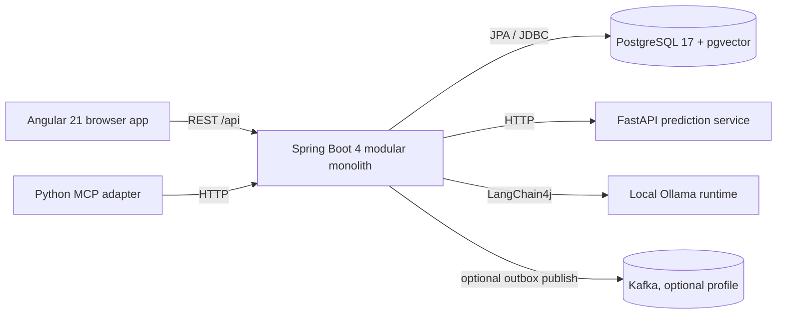

# System architecture

**Status: Existing and verified** for source boundaries; **planned, not implemented** for the future service fleet. This document describes repository evidence, not deployment certification.

## Current application

- `frontend/` is the existing Angular application. Its routes remain where they are; no speculative feature folders or duplicate components are generated.
- `backend/spring-boot-app/` owns the current REST API, tenant-aware persistence, migrations, security configuration, AI orchestration, and audit/outbox modules.
- `ml-service/` owns model inference and data-only model artifacts. It is not a second business API.
- PostgreSQL is the system of record and also stores RAG embeddings through pgvector.
- `mcp-server/` is a separate adapter. Secure identity propagation and full authorization are not yet proven.
- The default Compose stack contains PostgreSQL, ML, and Spring Boot. Kafka and Ollama are opt-in profiles added for local infrastructure; no model downloads occur automatically.

The live call paths and health checks are documented in [API overview](../api-contracts/api-overview.md) and [Windows development setup](../setup/windows-development.md). A local startup or unit test does not certify a production deployment.

## Future service decomposition

**Planned, not implemented.** The existing Spring application remains the operational backend. Proposed extraction boundaries and ownership are in [service boundaries](./service-boundaries.md). Do not create deployable-looking empty services or move working code until an operational need and migration plan are approved.

## Request and event flows

- Interactive directory, dashboard, prediction, risk, and assistant requests remain synchronous REST requests.
- Spring calls FastAPI for model inference and Ollama for local language/embedding work.
- Selected audit writes persist an audit row and outbox row transactionally. The publisher is disabled by default. Kafka consumers, dead-letter handling, and end-to-end broker verification remain unfinished.
- No frontend login/callback flow or identity service is currently delivered. Secure backend mode delegates JWT validation to an external OIDC issuer.

## Deployment boundaries

Compose publishes host ports on loopback. Container-to-container calls use Compose service names. Actuator is on the separate management port. Local/demo mode is unauthenticated and must not be exposed to untrusted networks. Production configuration, secrets, identity, TLS, network policy, backups, and monitoring require deployment-specific validation.
